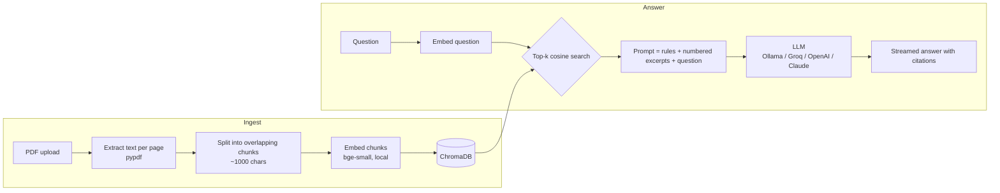

# 📄 Chat with your PDFs

Upload PDFs and ask questions about them in plain English. Answers come back with **page-level citations**, so you can check every claim against the source.

Built from scratch as a compact, readable **Retrieval-Augmented Generation (RAG)** pipeline: no LangChain, no magic, under 600 lines of Python you can read in one sitting. It runs **100% free and local** with Ollama, or with Groq, OpenAI or Claude if you have a key.


<!-- TODO: record a short GIF of uploading a PDF and asking a question, save it as assets/demo.gif -->


## Features

- **Multi-PDF chat** with streaming answers and follow-up questions that remember the conversation
- **Cited answers**: every answer cites numbered excerpts, and a "Sources" panel shows the file, page and similarity score
- **Swap the LLM from the sidebar**: Ollama (local, free), Groq (free tier), OpenAI or Anthropic Claude
- **Free local embeddings** with [`BAAI/bge-small-en-v1.5`](https://huggingface.co/BAAI/bge-small-en-v1.5), so indexing never costs anything
- **ChromaDB** vector store, in-memory by default or persisted to disk
- Tested with **pytest** (runs offline in about 2 seconds) and linted with **ruff** in GitHub Actions

## How it works



1. **Load**: `pypdf` extracts the text of each page, keeping the page number for citations.
2. **Chunk**: a recursive splitter breaks text on paragraphs, then lines, then sentences, then words, and packs pieces into ~1000-character chunks with 150 characters of overlap, so an idea split across a boundary still appears whole in one chunk.
3. **Embed**: each chunk becomes a 384-dimension vector. Similar meanings land close together, so "time off" finds a passage about "paid leave".
4. **Retrieve**: the question is embedded the same way and ChromaDB returns the 4 nearest chunks by cosine similarity.
5. **Generate**: the LLM gets a short system prompt ("answer only from the excerpts, cite them, say so if the answer isn't there") plus the numbered excerpts, and streams its answer.

## Project structure

```
├── app.py               # Streamlit UI
├── rag/
│   ├── loader.py        # PDF -> pages
│   ├── chunker.py       # pages -> overlapping chunks
│   ├── embeddings.py    # sentence-transformers wrapper
│   ├── vector_store.py  # ChromaDB add/search
│   ├── llm.py           # one streaming interface over 4 providers
│   ├── pipeline.py      # ingest -> retrieve -> answer
│   └── config.py        # settings from .env
└── tests/               # offline tests with a fake embedder and LLM
```

## Getting started

### 1. Install

Requires Python 3.10+.

```bash
git clone https://github.com/Rashmika113/PDF-chatapp.git
cd PDF-chatapp
python -m venv .venv
source .venv/bin/activate        # Windows: .venv\Scripts\activate
pip install -r requirements.txt
cp .env.example .env             # Windows: copy .env.example .env
```

The first run downloads the embedding model (~130 MB) from Hugging Face.

### 2. Pick an LLM

**Option A: Ollama (free, runs on your machine, nothing leaves your computer)**

1. Install Ollama from [ollama.com](https://ollama.com/download).
2. Pull a model: `ollama pull llama3.2` (about 2 GB; needs roughly 8 GB of RAM).
3. Keep `LLM_PROVIDER=ollama` in `.env`.

**Option B: Groq (free tier, fast, no GPU needed)**

1. Create a free key at [console.groq.com/keys](https://console.groq.com/keys).
2. In `.env`, set `LLM_PROVIDER=groq` and `GROQ_API_KEY=...`.
3. The default model is `openai/gpt-oss-120b`. Groq retires models from time to time, so if you get a 404, pick a current one from the [Groq playground](https://console.groq.com/playground) and set `GROQ_MODEL` in `.env`.

**Option C: OpenAI or Anthropic (paid)**

Set `OPENAI_API_KEY` or `ANTHROPIC_API_KEY` in `.env`, or paste the key in the sidebar at runtime. Model names are configurable in `.env` too.

### 3. Run

```bash
streamlit run app.py
```

Open http://localhost:8501, upload a PDF in the sidebar, and start asking questions.

## Configuration

All settings live in `.env` (see [`.env.example`](.env.example)):

| Variable | Default | What it does |
|---|---|---|
| `LLM_PROVIDER` | `ollama` | Provider selected when the app opens |
| `EMBEDDING_MODEL` | `BAAI/bge-small-en-v1.5` | Any sentence-transformers model |
| `CHUNK_SIZE` / `CHUNK_OVERLAP` | `1000` / `150` | Chunk length and overlap, in characters |
| `TOP_K` | `4` | Number of excerpts sent to the LLM |
| `CHROMA_DIR` | *(empty)* | Folder to persist the index; empty keeps it in memory |

## Running tests

```bash
pip install -r requirements-dev.txt
pytest
ruff check .
```

Tests swap in a tiny bag-of-words embedder and a fake LLM, so they run offline without downloading models or calling APIs.

## Limitations and ideas for next steps

- Scanned PDFs (images of text) have no extractable text. Adding OCR (e.g. `pytesseract`) would fix that.
- Retrieval is pure vector search. **Hybrid search** (BM25 + vectors) and a **cross-encoder reranker** would improve precision on keyword-heavy questions.
- Add an **evaluation set** (question, expected answer, expected page) to measure retrieval hit rate and answer faithfulness when tuning chunk size or `TOP_K`.
- Deploy to Hugging Face Spaces or Streamlit Community Cloud with Groq as the backend.

## License

[MIT](LICENSE)
